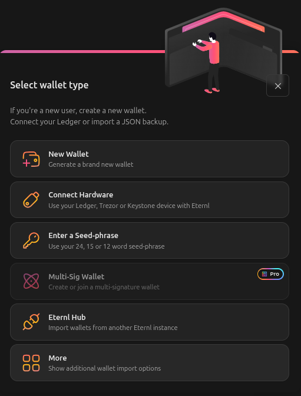
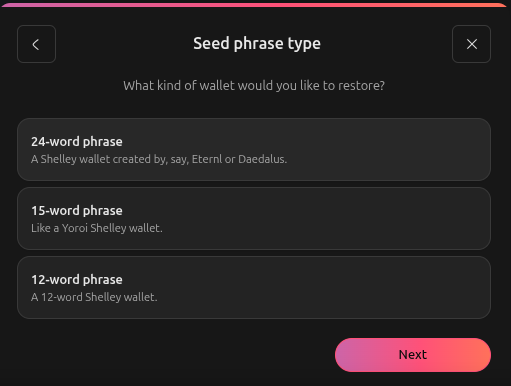
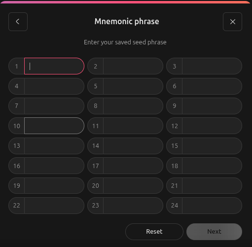

# Test wallets

Two wallets are ready for testing on the Cardano **Preview** testnet. Each one holds:
- PT of the Milestone 3 pools, as left after the last trade of the test on 05 Nov 2026 (table below, in PT units);
- the test tokens needed to buy: test ADA, USDC, DJED and SNEK.

| PT | Pool | Matures (UTC) | Wallet 1 | Wallet 2 |
|---|---|---|---|---|
| PT ADA | A1 | 2026-11-05 17:00 | 100,000,000 | 899,999,999 |
| PT USDC | A2 | 2026-11-05 17:00 | 19,999,999,999 | 80,000,000,000 |
| PT DJED | A3 | 2026-11-05 17:00 | 339,999,999 | 660,000,000 |
| PT SNEK | A4 | 2026-11-05 17:00 | 14,999, plus 40,000 listed (ASK-14) | 45,000 |
| PT ADA | B1 | 2026-11-04 22:00 | 499,999,999 | 0 |
| PT USDC | B2 | 2026-11-04 22:00 | 20,000,000,000 | 24,999,999,999, plus 5,000,000,000 listed (ASK-19) |
| PT DJED | B3 | 2026-11-04 22:00 | 479,000,000 | 20,999,999 |
| PT SNEK | B4 | 2026-11-04 22:00 | 40,000 | 9,999 |

After maturity, the PT of a pool is redeemed in **My Account**, see the [user guide](USER_GUIDE.md).

> **Preview testnet only.** These recovery phrases are published on purpose, so that anyone can test. Never send mainnet funds to these wallets.

## Wallet 1

- Address: `addr_test1qq5d0puzqsp70uut68m9kj7djwfhq2gy88gxj5g6mke8f7qudwk64wkcpnsyu9mcg2nu3kxkuyspwrh5x5ghj0u94ucsvz7r3n`
- Recovery phrase: `collect energy planet trust share flush offer hundred visit tomato negative abandon medal bike turtle pool tray skull critic unit proof learn burger ridge`

## Wallet 2

- Address: `addr_test1qz8r8mdqunhr5cl0d0936274upx2qwuhhcnrfurxudxuxlj62s4ndurtq2k8pf8laeqzpgnn9rcgrp8wpae58wnsa3dqgkwfy0`
- Recovery phrase: `city welcome over diary obscure budget fire chunk other summer call awake addict basket father jealous skull chimney ranch like amused pony enhance sure`

## Restore a test wallet in Eternl

Do this once for each wallet you want to use.

1. Install the Eternl browser extension (https://eternl.io) and open it.
2. In Eternl's settings, switch the network to **Preview**.
3. Click **Add wallet**, then choose **Enter a Seed-phrase**.

   

4. Choose **24-word phrase** and click **Next**.

   

5. Copy the wallet's whole recovery phrase from above. Click the first box and paste: the 24 words fill the boxes in order. Click **Next**.

   

6. Give the wallet a name, for example *Zero Coupon – Wallet 1*, set a spending password, and finish.
7. Check that the wallet's address matches the one listed above.
8. Set up collateral in Eternl's settings.
9. Open https://app.zerocoupon.site and follow the [user guide](USER_GUIDE.md).
